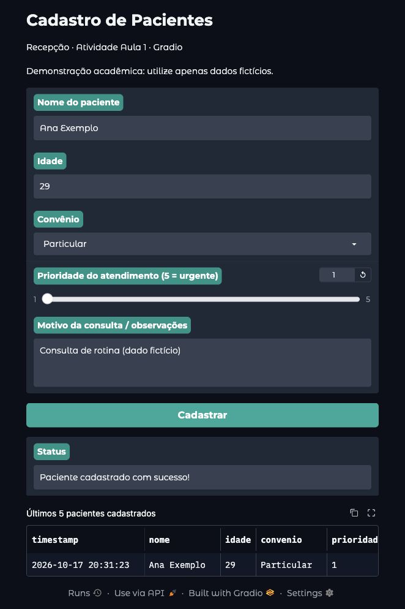
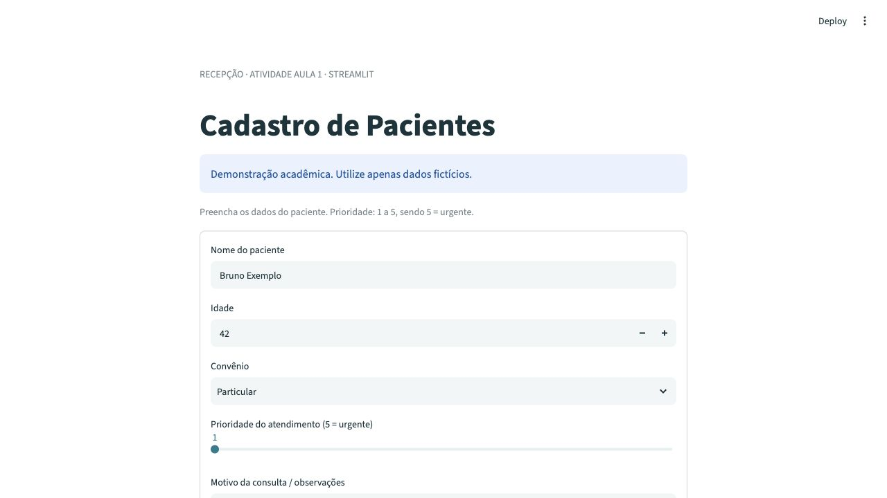

# Entrega · Atividade Aula 1

**Autora:** Naomi Pomella  
**Disciplina:** Aplicações em Data Science  
**Tema:** Interfaces Web/Mobile para Coleta de Dados: Gradio × Streamlit

## Repositório

[nomi-npr/pos_unicamp](https://github.com/nomi-npr/pos_unicamp)

As duas versões estão em `atividade_01/gradio_app/` e `atividade_01/streamlit_app/`. O arquivo `atividade_01/app.py` é o ponto de entrada da versão Streamlit.

## Publicação

Status: aguardando autenticação no Streamlit Community Cloud. O endereço público será registrado aqui após a publicação e a verificação do aplicativo.

## Evidências

### Gradio local

Interface executada em `http://127.0.0.1:7860`, com cadastro fictício gravado em CSV e mensagem de confirmação:

### Streamlit local

Formulário executado em `http://127.0.0.1:8501`, com cadastro, tabela da sessão e exportação CSV:

### CSV de exemplo

[Baixar pacientes.csv](../exemplos/pacientes.csv). Gerado pela rotina compartilhada de persistência com cinco registros fictícios, os cinco convênios e prioridades de 1 a 5. Inclui data/hora, nome, idade, convênio, prioridade e motivo.

## Verificação

- Seis testes automatizados aprovados (`python -m unittest discover -s atividade_01/tests -v`).
- Criação do CSV com cabeçalho e acréscimo sem apagar registros anteriores.
- Preservação de acentos, vírgulas, aspas e quebras de linha.
- Rejeição de dados inválidos e gravação simultânea sem cabeçalhos duplicados.
- Cadastro Streamlit acumula seis registros, exibe os últimos cinco e mantém os dados durante reexecuções.
- Sessões Streamlit independentes não herdam cadastros de outros visitantes.
- Cadastro realizado pela interface Gradio e pela interface Streamlit no navegador.
- Download Streamlit executado e CSV baixado conferido.
- Dependências verificadas com `python -m pip check`.

O teste em celular físico e o teste do endereço público ainda dependem da publicação. Os formulários usam disposição em coluna única.

## Comparação

A comparação entre vantagens, limitações e fluxos de publicação está no [README](../README.md#comparação-prática).
