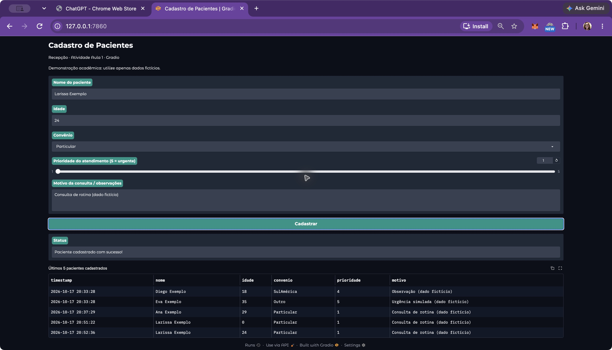
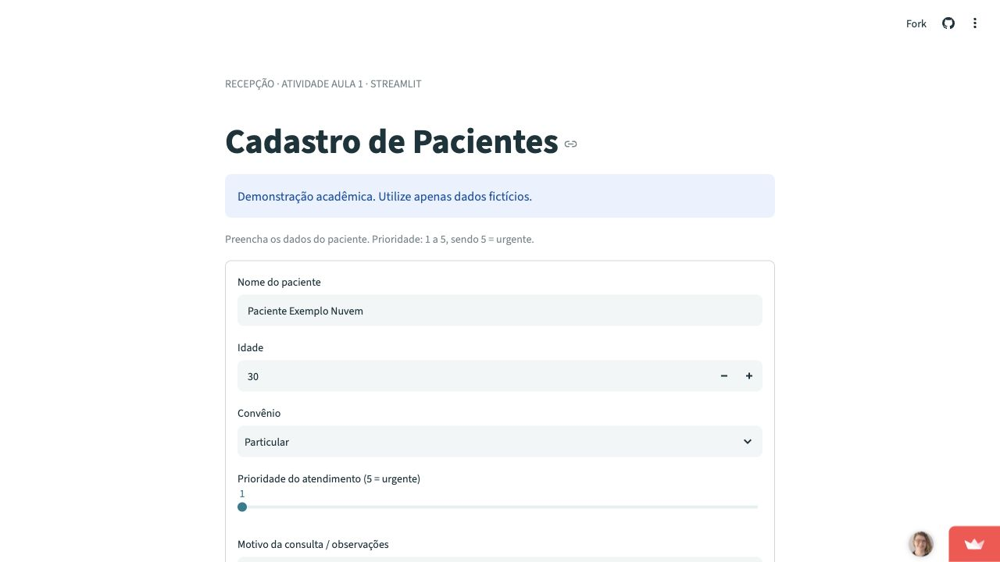
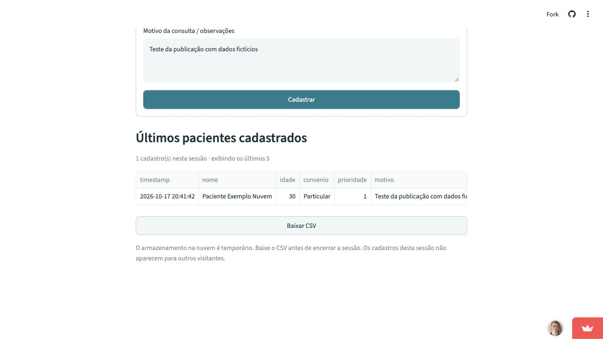
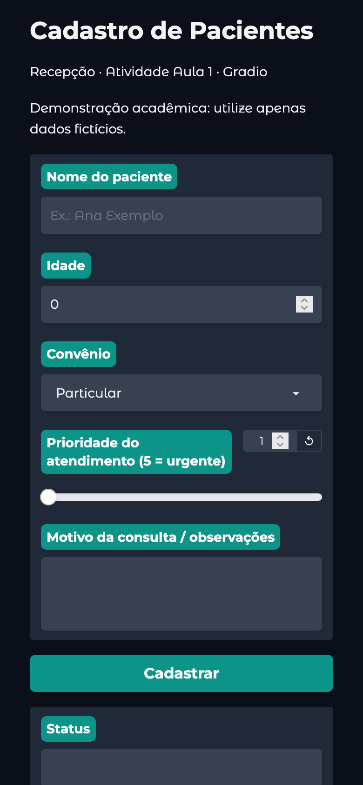
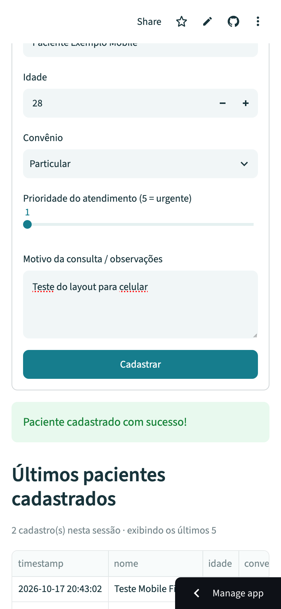

# Entrega · Atividade Aula 1

**Autora:** Naomi Pomella  
**Disciplina:** Aplicações em Data Science  
**Tema:** Interfaces Web/Mobile para Coleta de Dados: Gradio × Streamlit

## Repositório

[nomi-npr/pos_unicamp](https://github.com/nomi-npr/pos_unicamp)

As duas versões estão em `atividade_01/gradio_app/` e `atividade_01/streamlit_app/`. O arquivo `atividade_01/app.py` é o ponto de entrada da versão Streamlit.

## Publicação

[Abrir app público](https://nomi-unicamp-atividade-01.streamlit.app/)

Publicado no Streamlit Community Cloud em 17/10/2026, usando a branch `main`, o arquivo `atividade_01/app.py` e Python 3.12. Cadastro e download verificados no endereço público, sem login de visitante.

## Evidências

### Gradio local

Interface executada em `http://127.0.0.1:7860`, com cadastro fictício gravado em CSV e mensagem de confirmação. Captura da janela completa, sem recorte, com endereço local, formulário e tabela visíveis (zoom de 67% para enquadrar toda a interface):

Captura adicional da página:

### Streamlit local

Formulário executado em `http://127.0.0.1:8501`, com cadastro, tabela da sessão e exportação CSV:

### Streamlit publicado

Cadastro fictício realizado no endereço público e CSV exportado e conferido:

### Layout para celular

Interfaces verificadas no modo responsivo do navegador, em viewport de 390 × 844 pixels. O formulário público também foi preenchido e enviado nesse tamanho.

### CSV de exemplo

[Baixar pacientes.csv](../exemplos/pacientes.csv). Contém 12 registros fictícios, os cinco convênios e prioridades de 1 a 5. Inclui data/hora, nome, idade, convênio, prioridade e motivo. Os cinco registros originais foram preservados e os sete adicionais usam a mesma validação das interfaces.

## Verificação

- Seis testes automatizados aprovados (`python -m unittest discover -s atividade_01/tests -v`).
- Criação do CSV com cabeçalho e acréscimo sem apagar registros anteriores.
- Preservação de acentos, vírgulas, aspas e quebras de linha.
- Rejeição de dados inválidos e gravação simultânea sem cabeçalhos duplicados.
- Cadastro Streamlit acumula seis registros, exibe os últimos cinco e mantém os dados durante reexecuções.
- Sessões Streamlit independentes não herdam cadastros de outros visitantes.
- Cadastro realizado pela interface Gradio e pela interface Streamlit no navegador.
- API local Gradio verificada com envio inválido rejeitado e quatro cadastros fictícios persistidos.
- Download Streamlit executado e CSV baixado conferido.
- Cadastro e download no endereço público executados e CSV conferido.
- Formulários conferidos em viewport móvel de 390 × 844, com cadastro público realizado.
- Dependências verificadas com `python -m pip check`.

O teste de layout móvel foi feito por simulação de viewport no navegador. A conferência em celular físico permanece para a autora, acessando o mesmo link público. Os formulários usam disposição em coluna única e as tabelas permitem rolagem horizontal.

## Comparação

A comparação entre vantagens, limitações e fluxos de publicação está no [README](../README.md#comparação-prática).
