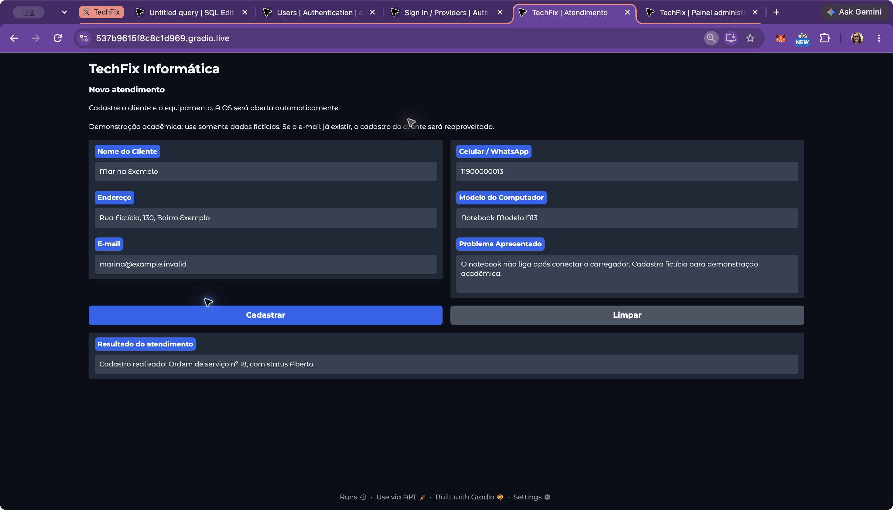
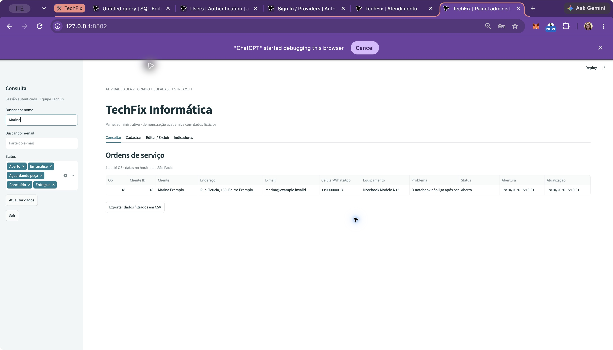
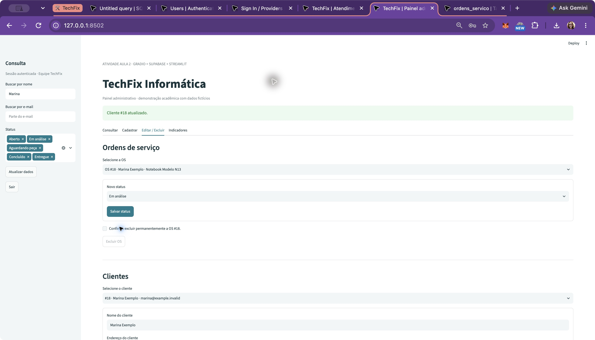
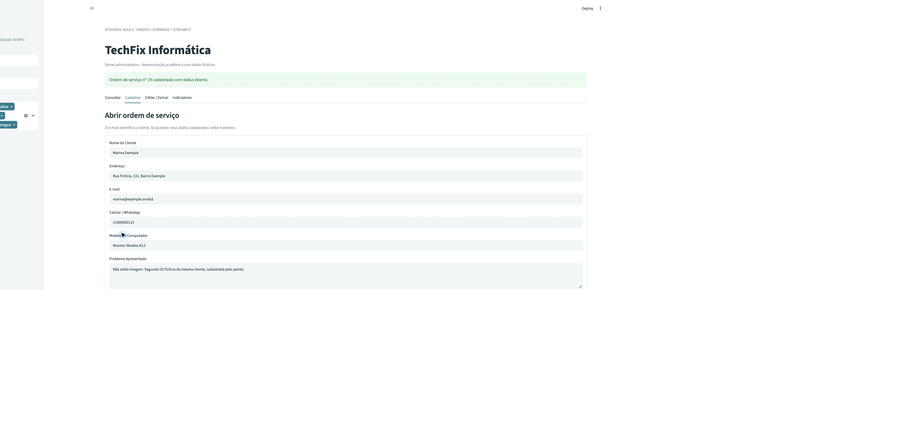
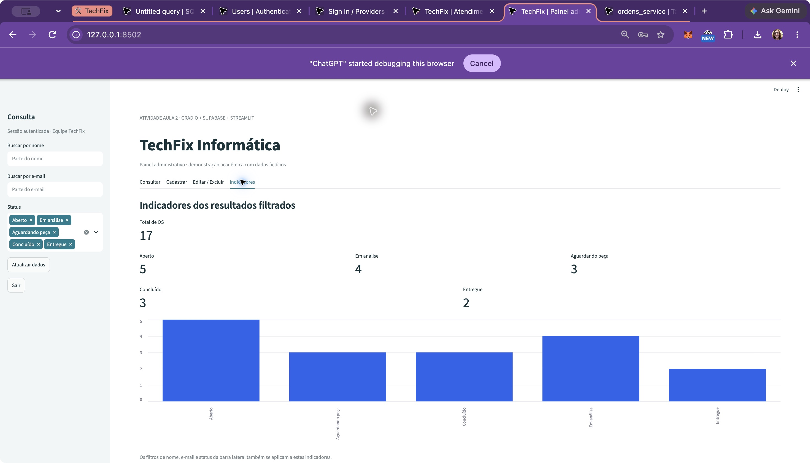
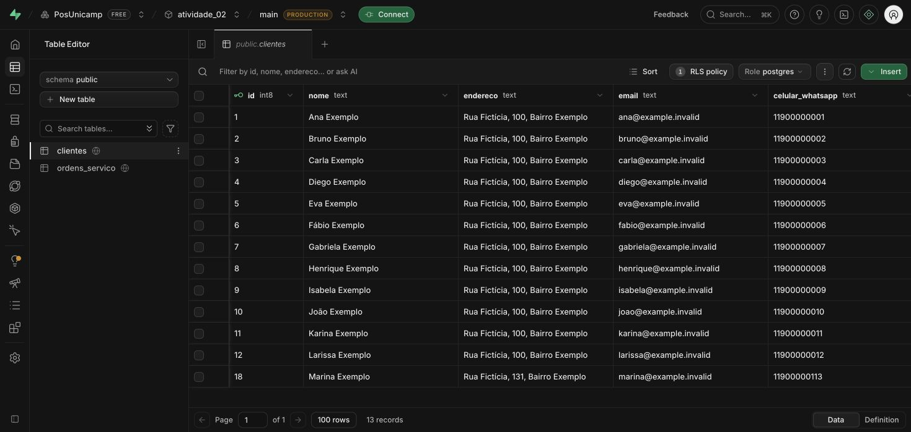
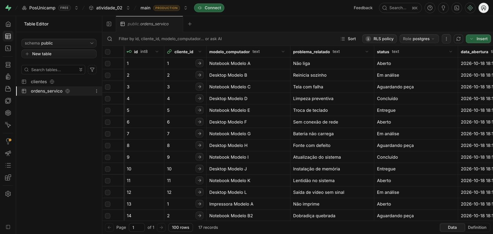

# Entrega · Atividade Aula 2

Autora: Naomi Pomella.

[Código no GitHub](https://github.com/nomi-npr/pos_unicamp/tree/main/atividade_02/techfix)

## Implementação

- Tabelas clientes e ordens_servico relacionadas, com PK, FK RESTRICT, NOT NULL, e-mail único e validações de status, e-mail e celular.
- Índices e atualização automática da data de alteração.
- Cadastro atômico por RPC, reaproveitando o cliente pelo e-mail sem sobrescrever seus dados.
- Gradio com seis campos, validação, confirmação com número da OS, Limpar e layout responsivo.
- Streamlit com login da equipe, consulta, filtros por nome/e-mail/status, cadastro, edição, exclusão com confirmação, métricas e gráfico.
- Exportação dos resultados filtrados em CSV (desafio opcional).
- Chave pública nas interfaces; credenciais locais fora do Git. A chave administrativa não é aceita pelas interfaces.

## Verificação em 18/10/2026

- **13 testes Python aprovados**, incluindo configuração segura, transporte Supabase, validações, paginação, filtros, CSV e operações das interfaces.
- **8 grupos SQL aprovados em PostgreSQL/PGlite local**: esquema, RLS, permissões, reuso, atomicidade, restrições, CRUD e seed idempotente.
- **Integração com o Supabase remoto aprovada**: cadastro público, reuso do cliente, alteração de status, trigger de atualização, edição de contato, FK RESTRICT e exclusão de registros descartáveis criados exclusivamente pelo teste.
- RLS impede consultas de visitantes nas duas tabelas; novos cadastros públicos de contas Auth e login anônimo estão desativados. A conta da equipe foi criada pela autora.
- Gradio público cadastrou a **OS 18** para Marina Exemplo. O painel autenticado alterou seu status para **Em análise**, editou endereço/celular e cadastrou a **OS 19**, reaproveitando a cliente.
- Filtro por Marina retornou sua OS; o CSV baixado pelo botão foi lido e conferido (1 linha, 11 colunas, antes do segundo atendimento). Consulte [consulta-marina.csv](consulta-marina.csv).
- Layout conferido em emulação com viewport 390 × 844, sem rolagem horizontal. O link público está disponível para teste também em um celular físico.
- O banco terminou com **13 clientes e 17 OS fictícias**: 5 Aberto, 4 Em análise, 3 Aguardando peça, 3 Concluído e 2 Entregue. O seed isolado contém 12 clientes e 15 OS; as interfaces adicionaram os dois atendimentos demonstrados.
- Dependências consistentes e os seis testes da atividade 01 continuam aprovados na verificação de compatibilidade realizada durante esta implementação.

## Acessar

- [Gradio — link público temporário](https://537b9615f8c8c1d969.gradio.live/)
- [Streamlit — painel local](http://127.0.0.1:8502/)

O link Gradio foi gerado em 18/10/2026 e depende do processo local em execução. Ao reiniciar o Gradio, copie o novo endereço exibido no terminal. O painel usa a conta Auth da equipe; nenhuma senha acompanha a entrega.

## Evidências das interfaces e do banco real

### Cadastro confirmado no Gradio — janela inteira

### Consulta filtrada e exportação CSV

### Edição de cliente e status

A confirmação de atualização do cliente aparece junto à OS 18 já em análise. Os botões de exclusão permanecem desabilitados até a confirmação explícita.

### Cadastro manual no painel

### Indicadores do banco remoto

### Tabelas preenchidas no Supabase

Consulte o [README](../README.md) para instalação, configuração, execução e testes.
