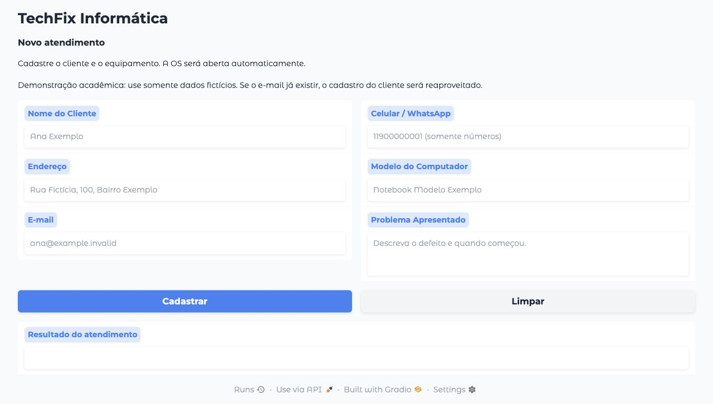

# Entrega · Atividade Aula 2

Autora: Naomi Pomella.

[Código no GitHub](https://github.com/nomi-npr/pos_unicamp/tree/main/atividade_02/techfix)

## Implementação

- Duas tabelas relacionadas, PK, FK com RESTRICT, NOT NULL, e-mail único, CHECK para os cinco status, e-mail e celular.
- Índices de cliente/status/data e atualização automática da data de alteração.
- Cadastro atômico via RPC, reaproveitando cliente pelo e-mail.
- Gradio com seis campos, validação, confirmação com número de OS, Limpar, layout responsivo e `share=True` por padrão.
- Painel Streamlit com login da equipe, consulta com dados do cliente, filtros, cadastro, edição, confirmação de exclusão, métricas e gráfico.
- Exportação CSV dos dados filtrados (desafio opcional).
- Credenciais em `.env`/secrets ignorados pelo Git; `.env.example` sem valores reais.
- Seed com 12 clientes e 15 OS fictícias.

## Estado da verificação

Verificado em 18/10/2026:

- 11 testes Python aprovados: transporte da biblioteca Supabase, validação, consultas paginadas, filtros, CSV, cadastro, edição, confirmação de exclusão e login do painel.
- 8 grupos SQL aprovados em PostgreSQL/PGlite local: criação do esquema, RLS/grants, RPC pública restrita, reuso do cliente, atomicidade, restrições, CRUD e seed sem duplicação.
- Formulário Gradio aberto no navegador local; envio inválido rejeitado e botão Limpar conferido nos seis campos e no resultado.
- Dependências consistentes (`pip check`) e os seis testes da atividade 01 continuam passando.

O projeto Supabase remoto ainda não foi configurado neste ambiente: o arquivo `.env` está sem URL/chave e o navegador solicita login.

[Formulário Gradio em link temporário](https://7a3a7a92dd591d16c9.gradio.live/), gerado em 18/10/2026. O formulário foi conferido no endereço público; a gravação permanece dependente da configuração do Supabase. O link pode expirar e depende de o processo local continuar rodando.

As capturas de cadastro confirmado, tabelas preenchidas no Supabase e CRUD integrado só serão acrescentadas após testar o projeto remoto. Capturas de testes simulados não serão apresentadas como evidências de integração real.

### Formulário local

Captura do formulário real em execução na porta 7861. Esta imagem demonstra a interface, sem representar um cadastro confirmado no banco remoto:

## Pendências externas

1. Entrar no Supabase e criar/selecionar um projeto dedicado.
2. Executar `sql/schema.sql` e `sql/seed.sql` no projeto.
3. Configurar a URL/chave pública no `.env` e uma conta Auth da equipe.
4. Testar as interfaces contra o Supabase, gerar o link temporário e registrar capturas.

Consulte o [README](../README.md) para os passos de configuração e execução.
